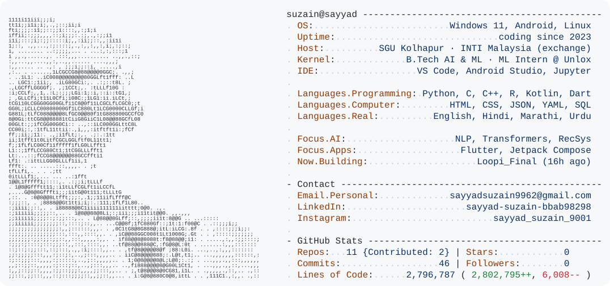
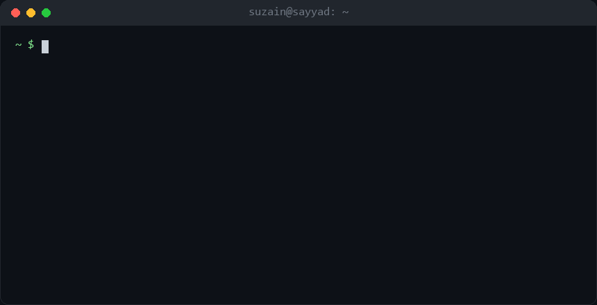

<!-- Header: animated wave -->

<!-- Neofetch card: rebuilt every day by .github/workflows/update-card.yml -->
<picture>
  <source media="(prefers-color-scheme: dark)" srcset="assets/card_dark.svg">
  
</picture>

  

   

## `$ whoami`

## 🛠️ Tech stack

  <b>Languages</b> 
    
  <b>ML &amp; Apps</b> 
    
  <b>Tools</b> 
  

## 🚀 Featured projects

| Project | What it does | Built with |
|---|---|---|
| 🔍 **[TextTrace](https://github.com/sayyadsuzain9001/TextTrace)** | AI-generated text detection studio. Upload a document, find the AI-written passages, get a highlighted report. | Python, PyTorch, DistilRoBERTa, Streamlit |
| 🔁 **[Loopi](https://github.com/sayyadsuzain9001/Loopi_Final)** | Offline-first Android study app: flashcards, weak-topic finder and confidence-vs-result tracking. | Kotlin, Jetpack Compose, Room |
| ✨ **[MT Alchemy](https://github.com/sayyadsuzain9001/MT-Alchemy)** | People-development platform: corporate site, learning portal, store and role-based workspaces. | Flutter, Firebase, Stripe, Gemini |
| 🚗 **[Car Price Prediction](https://github.com/sayyadsuzain9001/Indian-Pre-Owned-Car-Price-Prediction)** | End-to-end ML pipeline predicting Indian used-car prices, deployed on Streamlit. | scikit-learn, CatBoost, Streamlit |
| 🤝 **[Profile Matching](https://github.com/sayyadsuzain9001/Profile-Based-Matching-System)** | Hybrid recommender using TF-IDF, cosine similarity, MBTI compatibility and feedback learning. | Python, NLP, scikit-learn |

## 📈 Activity

<!-- Snake: regenerated every day by .github/workflows/snake.yml -->
<picture>
  <source media="(prefers-color-scheme: dark)" srcset="https://raw.githubusercontent.com/sayyadsuzain9001/sayyadsuzain9001/output/github-snake-dark.svg">
  
</picture>

